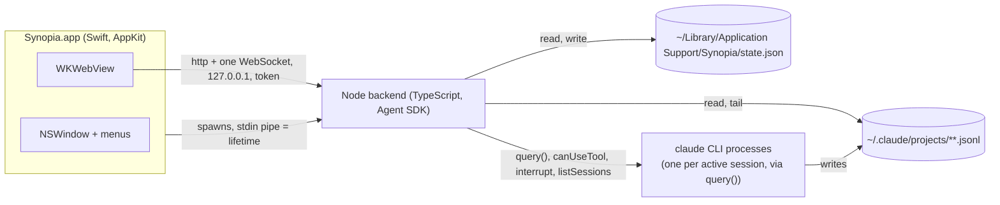

# Synopia milestone 1: technical plan

> 🧭 **What:** milestone 1 makes the prototype real. You open Synopia as its own app on your machine. You start sessions in it, or open ones you've closed in the terminal, and chat in them with everything the prototype shows. You can stop using the terminal.
> **In scope:** new sessions, opening a past session, transcripts with subagents and background work, files and diffs, the needs-you cards answered through the SDK, Claude-written titles and "Now" lines, keys and modes (including interrupt), the per-session model, drag-and-drop groups, Close session, the app icon.
> **Out of scope:** any knowledge of terminal sessions, Dock badge and notifications, drift detection and "Split into a new session", the closing note with loose ends, new worktrees, Claude's first grouping suggestion, messaging a running subagent, the stale, rate-limited, compacting, credentials-expired and queued states.
> **Sources:** `docs/requirements.md` (behaviour), `prototype/app.html` (look), `spike/FINDINGS.md` (SDK), `spike/native-shell/` (shell), `export_transcripts.py` (reference parser), `.ai-notes/app/README.md` (handover). Read at `150ed5d` on 2026-11-23. The source digests and the decisions sit in `.attack-plan/synopia-m1/`.

## Contents

0. Summary
1. Architecture
2. The shell
3. The backend
4. The page
5. Protocol
6. Sessions: new, open, drive, stop, close
7. Transcripts
8. Status
9. Needs you: questions, permissions, plans
10. Claude-written titles and Now lines
11. Persistence
12. Security and privacy
13. Dependencies outside the documented SDK
14. Verification
15. Slices and tasks
16. Risks
17. Assumptions to verify
18. Ruled out

## 0. Summary

- **Today:** the prototype is one HTML page that polls `transcripts.js` every 10 s and rebuilds everything. `export_transcripts.py` writes that file by re-parsing every transcript. Every send, answer, close and new session is a stub. Permission and plan cards exist only through `?demo=`. A native Swift shell spike showed the page in a WKWebView under Jamf.
- **Goal:** the same page, in its own app window, driving real sessions. You chat, answer and arrange in it, and the terminal is no longer needed.
- **How:** three parts on one machine:
  - a native Swift shell, which owns the window, the menus and the backend's lifetime;
  - the prototype's page, split into plain script files and fed by one WebSocket;
  - a Node backend that runs each session through the Agent SDK, tails its transcript, and stores your layout.
- **Already decided** (author, 2026-11-23):
  - Synopia knows nothing about the terminal. It shows only the sessions it holds open: new ones, and past ones you open from a list. Running one session in both places is your call.
  - The transcript comes from the session's JSONL file. The SDK stream carries control and live state.
  - Sessions stay open until you close them, across restarts.
  - Sessions keep your permission mode, `auto`.
  - New sessions are empty sessions in `~/dev/demo-project`.
  - Titles and Now lines are written by Claude, with no limit on calls.
  - Esc, Esc interrupts.
  - The page reaches the backend over a local WebSocket guarded by a token.
  - The SDK and the CLI are used through their documented surface. The few undocumented things Synopia relies on sit in one module each, with a fallback.
- **Still open:** nothing blocks slice 1. Section 17 lists the facts the slices settle by a check as they go.
- **Delivery:** six slices, each usable and verifiable alone. Slice 1 lets you start a session in Synopia and chat in it.

## 1. Architecture



The build steps, in order:
1. **Shell.** It builds with `swiftc` from source, starts the backend, loads the page from it, provides the Edit menu, and quits cleanly.
2. **Backend core.** It serves the page, opens the WebSocket, keeps the state file and takes the single-instance lock.
3. **Session driver.** It runs one `query()` per active session, with streaming input, `canUseTool`, interrupt and model changes.
4. **Transcript reader.** It tails each session's JSONL by offset and turns records into the items the page already draws, with stable ids.
5. **Page.** It is the prototype, split into files, with a store fed by the protocol in place of `transcripts.js`. Each panel re-renders on its own.
6. **Writer.** It runs one-shot model calls for titles and Now lines.

Hard constraints, and how each is kept:
- **Nothing downloaded that Jamf could block.** The shell is built locally with the Command Line Tools (Swift 6.4, macOS 26.7 here). The backend runs on the installed Node (asdf `nodejs 22.13.1`). The npm packages are `@anthropic-ai/claude-agent-sdk`, whose `claude` binary already ran in the spike, and `ws`, which is pure JavaScript. Slice 1 starts by checking that a fresh `npm ci` installs on this machine. No Electron and no other runtime.
- **Privacy.** Test fixtures are written by hand from the formats digest, and no real transcript enters the repo. Notes in `.ai-notes/` record shapes and field names, never values.
- **The look.** The page is the prototype's markup and CSS, moved, not redrawn. New elements (the Open list, the interrupt prompt, the empty new session) reuse existing classes and go through the `frontend-design` skill.
- **Credentials.** Synopia never reads, logs or stores credentials. The SDK picks up Bedrock from `~/.claude/settings.json` as the CLI does.
- **Agents on this repo** never touch a live work session. Every live check uses a scratch session in a scratch folder on `haiku`.

Repository layout (new):

```
app/
  build.sh          builds build/Synopia.app with swiftc, makes the .icns, writes Resources/config.json
  dev.sh            runs the backend alone on a fixed port for Chrome, with its own state folder
  check.sh          unit tests, a shell type check, a page syntax check; prints the pass or fail line only
  shell/            main.swift, AppDelegate.swift, Backend.swift, Info.plist
  backend/          package.json and package-lock.json (pinned), src/*.ts, test/*.test.ts, test/fixtures/
  web/              index.html, css/app.css, js/*.js, icon/ (copied from prototype/icon)
prototype/          unchanged, stays the look reference
```

## 2. The shell

- **Build:** `app/build.sh` runs `swiftc -O shell/*.swift -framework Cocoa -framework WebKit` into `build/Synopia.app`.
  - It makes `Synopia.icns` from `prototype/icon/icon-1024.png` with `sips` and `iconutil`, which ship with macOS.
  - It writes `Contents/Resources/config.json` with `node`, the absolute path from `asdf which node` (falling back to `command -v node`), and `backend`, the path to `app/backend/src/main.ts` in this checkout. Apps opened from Finder don't get the asdf PATH. After a Node upgrade, rebuild.
  - The app runs the backend from the repo: one user, one machine, no copy of `node_modules`. `*.app/` is already in `.gitignore`.
- **Backend lifetime:** the shell spawns `node --experimental-strip-types --disable-warning=ExperimentalWarning <backend>` with stdin as a pipe.
  - The backend prints one line, `{"port":…,"token":…}`, on stdout.
  - The shell loads `http://127.0.0.1:<port>/?token=<token>`.
  - The backend exits when its stdin closes, so a crash of the shell never leaves an orphan.
  - If the backend exits, the shell shows its last stderr line in the window and offers "Restart backend".
- **Window:** one NSWindow, 1280×820, its frame saved with `setFrameAutosaveName`.
- **Integrated title bar** (R2.7, `TitleBar.swift`):
  - The window uses `.fullSizeContentView`, `titlebarAppearsTransparent` and `titleVisibility = .hidden`, and keeps the title "Synopia". The traffic lights stay where AppKit puts them (no toolbar, no private API): on macOS 26 the title bar is 32 pt and the buttons sit 9 to 23 pt down, 9 to 69 pt across, over the sidebar.
  - The content view is a `WindowFrame`: the web view (or the backend-down view) filling the window, and on top a transparent `DragStrip` over the sidebar column's top only: as wide as the sidebar (`WindowFrame.sidebarWidth`, 270 pt, kept in sync with the first track of `.app`) and as tall as the title bar (measured as the frame height minus `contentLayoutRect`, 28 pt before that), the empty area beside the traffic lights. The main area has no strip over it (decided 2026-11-24: dragging by the header isn't needed), so every click there goes to the page. `SYNOPIA_DEBUG_DRAG=1` logs the strip's frame to stderr. Its `mouseDown` calls `window.performDrag(with:)`. A double-click follows `AppleActionOnDoubleClick` from the global domain: `Minimize`, `None`, or zoom for `Maximize`, `Fill` and unset (falling back to the older `AppleMiniaturizeOnDoubleClick`). Every click outside the strip goes to the web view, so a drag in the sidebar never moves the window.
  - The page learns it through a `WKUserScript` at document start, refreshed and also evaluated on every change: the root classes `in-app` and `fullscreen`, and `--titlebar` set inline to the measured height (0 in fullscreen). `app.css` defaults `--titlebar` to 0, 28px under `html.in-app:not(.fullscreen)`. The sidebar (`.app > .side`) takes it as top padding, so its heading sits below the traffic lights; the main area keeps only its 9 px canvas gap, so the header panel starts 9 px from the window top, as in Slack and Linear.
  - In fullscreen (`windowWillEnterFullScreen`, `windowWillExitFullScreen` and the two failure callbacks) the strip is hidden and the page gets `fullscreen`.
- **Menus:** an App menu (About, Quit ⌘Q), an Edit menu (Undo, Redo, Cut, Copy, Paste, Select All, so ⌘V and ⌘C reach the web view) and a Window menu. No menu item takes ⌘⇧[ or ⌘⇧], so they reach the page.
- **Links and files:** the page never navigates. Every link and file click goes to the backend as `open`, the same in Chrome. As a safety net the shell's `WKNavigationDelegate` cancels any navigation away from the backend origin, and `createWebViewWith` returns nil. Both hand only `http` and `https` URLs to `NSWorkspace.open`.
- **Quit:** on ⌘Q the shell calls `GET /api/quit-check` with the token, which returns the running turns and running background work. If anything is running, an NSAlert says "Quit Synopia? 2 sessions are working and 1 background shell will stop." Then the shell closes the backend's stdin, and the backend ends its `query()` processes.

## 3. The backend

Node 22.13 with TypeScript run by `--experimental-strip-types`. There's no build step, as in the spike's `chat.ts`. Dependencies are pinned exact in `package.json` and `package-lock.json`: `@anthropic-ai/claude-agent-sdk@0.3.330` and `ws`. Install with `npm ci`. Tests run with `node --test`.

| Module | Job |
|---|---|
| `main.ts` | Parses flags: `--claude-dir` (default `~/.claude`), `--state-dir` (default `~/Library/Application Support/Synopia`), `--port` (default random), `--no-parent` (don't exit on stdin close, for `dev.sh`), `--fake` (fake driver). Takes the lock, starts the server, prints the port and token. |
| `server.ts` | HTTP for `app/web/` and the WebSocket on `/ws`, on 127.0.0.1. Checks the token, Host and Origin. |
| `lock.ts` | An exclusive lock file `backend.lock` in the state folder. A second backend on the same state folder exits with a message. |
| `sessions.ts` | The open list, new sessions, the Open list from `listSessions()`, close. |
| `driver.ts` | One SDK `query()` per active session: input queue, canUseTool, interrupt, setModel, process lifetime. |
| `tail.ts` | Byte-offset tailing of one file, with a line buffer for the partial last line. |
| `transcript.ts` | JSONL records to items, per session and per subagent, with stable ids. The port of `export_transcripts.py`, and the only code that reads the JSONL. |
| `status.ts` | One status per session from SDK events and pending requests. |
| `writer.ts` | Titles and Now lines through one-shot model calls. |
| `store.ts` | `state.json`: open sessions, layout, reviewed marks, models, session rules, written text, settings. |
| `menu.ts` | `supportedCommands()` and `supportedModels()`, cached per folder. |
| `open.ts` | Opens files and URLs with `/usr/bin/open` through `execFile`, never a shell. |
| `log.ts` | `~/Library/Logs/Synopia/backend.log`: event names and ids only. |
| `fake-driver.ts` | Replaces `driver.ts` under `--fake`. It plays scripted turns and pending requests over the fixture transcripts, so the page can be checked without model calls. It replaces the prototype's `?demo=`. |

## 4. The page

- **Files:** `app/web/` starts as a copy of `prototype/app.html`, split into classic `<script>` files with no modules, no build and no framework: `marks.js`, `md.js`, `sidebar.js`, `dnd.js`, `transcript.js`, `rail.js`, `card.js`, `composer.js`, `keys.js`, `store.js`, `bridge.js`. CSS goes to `css/app.css`.
- **Not carried over:**
  - code and rules for rejected or out-of-scope designs: `.g-why`, `.gagg`, `.ping`, `.slash`, `.mode`, `#send`, the drift warning, "Split into a new session", the "test state" tag, the "exported" footer;
  - `OVERLAY`, `GROUPS`, `?demo=` and `?type=`.
  - The card renderers for questions, permissions and plans stay. They are fed by `pending` instead of the demo.
- **Store:** one object `{sessions: Map, layout, reviewed, menu, settings, pending: Map, ui}`. `bridge.js` applies server messages to it and calls `render(part)` for the parts that changed.
- **Rendering per panel:** the prototype's `renderConv` is split into `renderHeader`, `renderLog`, `renderRail` and `renderCard`.
  - The composer is created once per session view and never re-rendered by data, so typing, focus, attachments and the mode never reset.
  - `renderLog` appends new items and replaces changed ones by item id, so a tool that goes from running to done changes only its line. It keeps the scroll at the bottom when you were within 40 px of it.
  - Open `<details>` and expanded diffs keep their state, because their ids come from item ids.
- **Time:** the 1 s timer that updates `[data-live]` spans also updates the ages ("Your turn, 12 min").
- **Kept from the prototype as they are:**
  - the "Working Ran(…)" line while a turn runs;
  - "Worked for 5s, done 02:24 PM";
  - day separators;
  - the "Recommended" tag;
  - the "… N earlier items not shown" line, now a quiet link "Show 160 earlier (N more)" (section 7);
  - image thumbnails in the composer;
  - the last four PR numbers in the header, from the `pr-link` records.
- **Fonts:** the prototype's Google Fonts link stays as it is. JetBrains Mono NL is used when installed, as now.
- **The subagent view's composer** keeps sending to the main conversation. Its placeholder says "Message <session title>", not "about this subagent", because messaging a subagent is out of scope.
- **New elements,** drawn with the existing classes and checked with the `frontend-design` skill against the prototype:
  - the empty new session: the header shows "New session" and the folder, the transcript is empty, and the message box is in insert mode;
  - **Open session**, a line under "New session" in the sidebar footer. It opens a list over the main area: recent sessions, newest first, with the title, folder and "2 h ago". j/k or the arrow keys move, Enter opens, Esc closes, and typing filters;
  - the interrupt prompt in the message box: "Interrupt? Esc again to stop. Any other key to keep working";
  - the effort levels in the model picker, as a second row of choices under the selected model, from `supportedEffortLevels`;
  - a quiet "Stop" row on an expanded Running card in the background work panel. Shell and monitor cards already expand, and subagent cards get the same expansion.

## 5. Protocol

One WebSocket, JSON text frames, `{t: "<type>", …}`. The first frame from the page must be `{t:"auth", token}`. The server keeps all state, so the page can reload at any time and get a full `hello`.

Server to page:

| Type | Fields | When |
|---|---|---|
| `hello` | `sessions[]` (meta and status, no items), `layout`, `reviewed[]`, `menu`, `settings`, `pending[]` | after `auth` |
| `session` | `id`, `replaces` (the placeholder id, once), and the changed fields: `title`, `now`, `cwd`, `prs`, `status`, `statusAt`, `model`, `effort`, `bg` counts, `toReview` | on change |
| `removed` | `id` | closed |
| `items` | `sid`, `agent` (null for the main conversation), `upsert[]` (items with `id`), `total`, `reset`, `prepend` | after a tail read; `reset` on first view and after a file is rewritten; `prepend` in reply to `earlier`, with the items before the oldest shown, oldest first |
| `agents` | `sid`, `upsert[]` (the subagent fields the page reads today) | a new subagent file or a meta change |
| `background` | `sid`, `upsert[]` | launch or notification |
| `pending` | `sid`, `request` (`{id, kind: question\|permission\|plan, agentId, since, …}`) or `cleared: id` | canUseTool parked or settled |
| `stream` | `sid`, `text` (the partial reply so far), or `clear` | while a reply is written |
| `recent` | `sessions[]` (`id`, `title`, `cwd`, `lastModified`) | reply to `listRecent` |
| `preview` | `path`, `display` (with `~`), `lang`, `html` (bat's GitHub colours as escaped `<span style>` runs, one line per `\n`), `lines`, `truncated` (past 5,000 lines or 2 MB), `size` | reply to `preview` |
| `menu` | `cwd`, `commands[]`, `models[]` | first view of a folder |
| `restore` | `sid`, `texts[]` | messages cancelled by an interrupt, back to the message box |
| `toolOutput` | `sid`, `agent`, `toolUseId`, `text` (the tool's full result), `truncated: false` | reply to `toolOutput`; a `toast` instead when the file is gone or was rewritten |
| `toast` | `text` | failures you must see |

Page to server:

| Type | Fields | Effect |
|---|---|---|
| `view` | `sid`, `agent` | subscribes to items for that session or subagent and gets `items` with `reset` |
| `earlier` | `sid`, `agent`, `before` (the oldest item id shown) | gets the 160 items before it as `items` with `prepend`; nothing when it isn't the viewed conversation or `before` is gone |
| `toolOutput` | `sid`, `agent`, `toolUseId` | gets the tool's full result, read again from its record's line in the JSONL (items carry only a preview) |
| `send` | `sid`, `text`, `images[]` (base64 PNG or JPEG, at most 5 MB each), `uuid` | pushes to the session's input, starting `query()` when none runs |
| `answer` | `sid`, `requestId`, `answer` | settles the pending canUseTool |
| `interrupt` | `sid` | interrupts the turn |
| `newSession` | none | creates an empty session in `settings.newSessionCwd` |
| `listRecent` | `filter` | asks for the Open list |
| `openSession` | `id` | adds a past session to the open list |
| `close` | `sid` | marks it closed and ends its process |
| `setModel` | `sid`, `model`, `effort` | stored, and applied when the process runs |
| `stopTask` | `sid`, `taskId` | stops one background subagent, shell or monitor |
| `layout` | `layout` | replaces the stored layout |
| `reviewed` | `agentId` | adds a reviewed mark |
| `open` | `path` or `url` | opens a file or an `https?` URL |
| `preview` | `path` | a text or source file (the `open` checks, a document or source extension or none, no NUL in the first 8 KB) gets `preview`; anything else is opened as `open` does; a bad path gets `toast` |

Items keep the prototype's shapes (`k: you|claude|tool|report|ask`, `patch`, `agents[]`, `background[]`), plus `id`; a tool item also has `patches[]` and `moreFiles` (a Bash command's edits), `input` (the command, or short input fields) and `out` `{text, lines, cut, interrupted?}` (its result's first 20 lines, 4 KB at most):
- the record `uuid`, with `:<block index>` for a block inside a record;
- for a tool, the `tool_use` id, so its result updates the same item.

## 6. Sessions: new, open, drive, stop, close

- **The open list** is `state.json` `open[]`: `{id, cwd, openedAt, closedAt}`. A session shows when it is in the list and not closed. Nothing else is discovered.
- **New session:** `newSession` adds a placeholder row with a local id, the folder `settings.newSessionCwd` (default `~/dev/demo-project`) and the title "New session".
  - The first `send` starts `query()` without `resume`. Messages sent before `system/init` arrives go into the same input queue, in order.
  - `system/init` gives the session id. The backend writes it to `open[]` and the layout, and sends `session` with `replaces`.
  - A placeholder you never sent anything to isn't stored, so it is gone after a restart.
- **Open session:** `listRecent` calls the SDK's `listSessions()`. It returns the 50 most recent by `lastModified`, leaving out the ones already open, with the title from `customTitle`, else `summary`, else `firstPrompt`. `openSession` adds the id and its `cwd` to `open[]`. The session resumes on your first message. Its transcript shows at once from the JSONL.
- **Driving** (`driver.ts`): one `query()` per active session, with streaming input (an async-iterable queue, as in `spike/chat.ts`). Options:
  - `cwd`, checked to exist first. A missing folder sets failed with "Folder … no longer exists", not a spawn error;
  - `resume` (none for a new session);
  - `model` and `effort` from `state.json` when set, else the last `requestedModel` and `effort` on the session's assistant records, so a resume keeps what the session used;
  - `permissionMode` left unset, so your `auto` setting applies, except that a session whose last `permission-mode` record is `plan` resumes with `permissionMode: 'plan'`;
  - `allowedTools` from the session's stored "Always allow" rules;
  - `canUseTool`;
  - `includePartialMessages: true`;
  - `perTaskStopAffordance: true`, so an interrupt stops only the foreground turn, as in the CLI, and background work is stopped one at a time with the Stop row;
  - `settings: {bashEditDiffEnabled: true}` (flag settings), so the CLI records the files a Bash command changed (`toolUseResult.bashEditDiff`) for "Files changed": it is off for SDK-driven sessions without it, and the writer's calls don't get it;
  - `env: {...process.env, CLAUDE_CODE_EMIT_SESSION_STATE_EVENTS: '1'}`;
  - `settingSources` left at its default, so your skills, commands, `CLAUDE.md`, hooks and agents load as in the CLI (verified in the spike).
- **Sending:** text and images are pushed with the page's `uuid`. A message sent during a turn is folded into it by the CLI, as in the terminal. A message sent while a card waits is queued behind the card, and the transcript shows "Queued until you answer the card above".
- **Model and effort:** `setModel(model)` changes the model of a running process, and `applyFlagSettings({effortLevel})` changes the effort. Both are stored per session and passed as options on the next start.
- **`/clear` and other resets:** a `conversation_reset` message moves the session to `new_conversation_id`. The backend replaces the id in `open[]`, the layout, the models and the rules, clears the written title and Now line, tails the new file, and sends `session` with `replaces`.
- **Ids the page still holds:** the backend keeps an alias map from each placeholder or reset id to the current id, so a late `send` or `view` with an old id reaches the right session.
- **Interrupt:** the first Esc in normal mode during a turn shows the prompt, and the second sends `interrupt`.
  - If `system/init` advertises the `interrupt_cancel_queued_v1` capability, the driver interrupts with `cancelQueued: true`, and the cancelled messages return to the message box through `restore`.
  - Otherwise it calls the typed `interrupt()`, and messages it lists as still queued run afterwards, as in the SDK. The toast says so.
  - An in-place field open on a card takes the first Esc for itself, as R6.4 says. Only an Esc with no open field starts the interrupt prompt.
  - The interrupt spares background subagents, shells and monitors. Each one has a Stop row on its expanded Running card, which calls the typed `stopTask(taskId)`.
- **Process lifetime:** a process ends when its session closes, when Synopia quits, or after 30 min idle with no running subagent or background work. Background shells and monitors live inside the process. The next message resumes it.
- **Process failure:** an exit outside these cases, or a resume that fails (for example the folder is gone), sets the status to failed and shows the stderr tail as a toast. The next message tries again.
- **Close:** `close` sets `closedAt` and ends the process, after a confirm when a turn or background work is running. It then sends `removed`. The layout keeps the closed id in its group, hidden. Reopening it from the Open list puts it back in its place.

## 7. Transcripts

- **Where:** the JSONL path is the first match of `projects/*/<sessionId>.jsonl` under `--claude-dir`, found again when the session is opened. Subagent files are in `<sessionId>/subagents/`. A new session has no file until its first turn, so it shows empty.
- **Tailing** (`tail.ts`), one tailer on the main file and one per subagent file:
  - It reads from the last offset to the end, keeps the partial last line until its newline arrives, and skips a line that isn't valid JSON.
  - If the file shrinks or its inode changes, it resets to 0 and sends `items` with `reset`.
  - Triggers: `fs.watch` on the file and the folder, plus a 1 s size poll, because watch events on macOS can merge or drop.
  - A subagent file seen before its `.meta.json` shows with the type "subagent" until the meta arrives. The session folder is watched, so a `subagents/` folder created later is picked up.
  - The poll compares size and mtime, so a rewrite to the same size still resets.
- **First read:** the whole file is parsed once and kept in memory as items. The largest transcript on this machine is 55 MB with lines up to 60 KB. Slice 1 times its first view (target under 2 s) and measures the memory. The page gets the last 160 items, with `total` for the "Show 160 earlier (N more)" link.
- **Earlier items:** the link, or `g` at the top of the log, sends `earlier` with the oldest item id shown. The server slices the 160 items before it from memory (no re-read), sends them with `prepend`, and widens that page's window to them, so upserts of those items reach it too. The page puts them first, skipping ids it has, and keeps the block you were reading at the same place on screen. Subagent views page the same way. A `reset` (a rewrite or a new `view`) goes back to the last 160. Near the start the link reads "Show 37 earlier"; at the first item it's gone.
- **Records to items** (`transcript.ts`): this is a port of `export_transcripts.py` lines 101 to 252, keeping its rules:
  - which user records are prompts, reports, slash commands or noise;
  - the tool verb table;
  - the tool state from results;
  - `structuredPatch` diffs, with `create` synthesized, the 400-line cut and counts;
  - AskUserQuestion questions and answers;
  - background shells and monitors from `run_in_background` and `Monitor`, closed by `<task-notification>`;
  - agent reports from `agent-message`;
  - titles from `ai-title` and `custom-title`;
  - PRs from `pr-link`.
- **Additions over the reference parser:**
  - stable item ids;
  - `system/turn_duration` for "Worked for" when present;
  - `permission-mode` records, for resume;
  - a subagent is running only when `finished` isn't `true`, its Agent tool has no result and no task notification has arrived, because `finished` is missing in 5 of 162 meta files;
  - `For review:` deliverables from the subagent `description`;
  - `[Request interrupted by user` prompts, for "Stopped".
  - The reference parser's secret redaction is not ported: the transcript shows on your own screen, and the export file it protected no longer exists.
- **Kinds that come in later slices:** until slice 4, subagent launches, reports, background items and patches render as plain tool lines, so nothing is missing, only plainer.
- **Streaming text:** `stream_event` deltas of the main conversation build a `stream` preview under the last item, keyed by message id and block index. Deltas with a `parent_tool_use_id` (subagents) are ignored. A block's preview is cleared when its record lands in the JSONL. The CLI writes one record per finished block, all with the message's id. Every preview is cleared on `result` and on interrupt.
- **Unanswered after a quit:** a question or plan whose process ended before you answered shows in the transcript as "Not answered (Synopia quit)". The session's status is your turn, and Claude asks again when you continue.

## 8. Status

One status per session in `status.ts`, from SDK events and the driver's own state, using the prototype's vocabulary:

| Status | Source |
|---|---|
| working (agent mark turning) | `session_state_changed: running`, or the driver started a turn. Also, with the main turn over, while the transcript has background subagents or forks running (not shells or monitors), for every open session, driven or not (added 2026-11-23). And with no Synopia process, while the transcript's main turn runs in another process: the latest assistant record has a `tool_use` without a result, or a prompt (user record, slash command or `queued_command` attachment) opened a turn that no `system/turn_duration`, `system/stop_hook_summary` or interrupt marker closed, and the transcript changed within 30 min |
| working, N messages queued (blue centre) | a message pushed during a turn, until a reply lists its uuid in `user_message_uuid(s)`; trimmed to a `result`'s `queued_turn_count`, emptied when the turn ends |
| compacting (rings shrinking) | `system/status` with `status: 'compacting'`, until another `system/status`, a `compact_boundary` or the turn's end |
| rate limited (amber dashes turning back) | `system/api_retry` with error `rate_limit` or HTTP 429, with its attempt and delay, until the next reply, `system/status`, another kind of retry or the turn's end |
| no updates (frozen grey arc) | a running turn, no card waiting, and no SDK message for 15 min (plus an announced retry delay), until the next message |
| signed out (lock) | `error` `authentication_failed` or `cloud_credential_error` on an `assistant` message or `api_retry`, or `auth_status` with an `error`; until the next turn starts or a main-thread reply comes without an error. Wins over everything but needs you |
| needs you (red seesaw) | a pending canUseTool request, which wins over everything (R6.8) |
| your turn (still grey square) | `idle` after a normal `result` with no subagent or fork running, and the state of a session whose process isn't running; its age counts from when the last subagent finished |
| stopped by you (grey square) | `idle` after a turn that ended by interrupt, or the last item is exactly `[Request interrupted by user]` (not `… for tool use`, a tool you turned down) with no assistant record after it |
| failed (red square) | `result` is an error that isn't an interrupt, or the process failed |

- **Without the undocumented flag** (a later CLI drops it), working runs from the first `send` to `result`. A unit test covers that path.
- **Age:** `statusAt` is the backend's clock when the status last changed, and it is stored, so ages survive a restart.
- **Background items** keep the prototype's rules: done, failed, stopped, and timed out computed for monitors.

## 9. Needs you: questions, permissions, plans

- **canUseTool parks the request.** The driver stores `{id: requestId, sid, toolName, input, options, since, resolve}` and sends `pending`.
  - A session can hold several requests at once, for example from parallel subagents. They are ordered by arrival. The card shows the oldest, and the header says "1 of 3".
  - A request stays until it is answered or its `signal` aborts, which happens on interrupt or when the process ends. A page reload gets it again in `hello`.
  - canUseTool never returns null.
- **The card's answer becomes the SDK's result:**

| Card | Choice | Returned to canUseTool |
|---|---|---|
| Question (AskUserQuestion) | options, notes, typed answers | `{behavior:'allow', updatedInput:{...input, answers:{[question]: label}, annotations:{[question]:{notes}}}}`. A multi-select answer is the chosen labels joined with `, `. "Type your own" sends the typed text as the answer |
| Permission | Allow once | `{behavior:'allow', updatedInput: input}` |
| Permission | Always allow | `{behavior:'allow', updatedInput: input, updatedPermissions: options.suggestions}`. Hidden when `suppressAlwaysAllowRule` is set or there are no suggestions. See the row text below |
| Permission | Deny, with an optional reason | `{behavior:'deny', message: reason or 'Denied by the user'}` |
| Plan (ExitPlanMode) | Approve | `{behavior:'allow', updatedInput: input, updatedPermissions:[{type:'setMode', mode: <the mode before plan mode>, destination:'session'}]}`. The mode before plan mode is the last non-`plan` `permission-mode` record, else `auto`, so approving returns you to `auto`. The mode reported afterwards is checked in S3-1 |
| Plan | Ask for changes | `{behavior:'deny', message: 'Changes: ' + text}` |

- **The "Always allow" row says exactly what is remembered and for how long** (R6.5). It has one clause per update entry in `suggestions`:
  - a rule saved in a settings file: "Always allow `Bash(npm run test:*)` in this project (.claude/settings.local.json)" or "everywhere (~/.claude/settings.json)";
  - a rule kept for the session: "for this session". Synopia stores session rules in `state.json` and passes them back as `allowedTools` on every resume, so "for this session" holds until you close it;
  - a mode change or an added directory, named as such: "and switch to accept edits", "and allow access to ~/dev/other".
- **The permission card shows** the command (Bash `input.command`, or the file path for Edit and Write), the folder, and Claude's reason (`input.description`, else `options.description` or `options.title`). A request from a subagent (`options.agentID`) names the subagent on the header line.
- **A card in another Claude Code process** (R6.8, 2026-11-24). With no Synopia process, a session whose transcript ends a thread (the main one, or a running subagent's) on an AskUserQuestion or ExitPlanMode tool_use with no tool_result (`Transcript.pendingAsk`) is needs you. This beats working by the transcript's running turn. The age counts from the tool_use's timestamp, the Dock badge counts the session, and the status clears when the result lands.
  - The backend sends the ask in the session meta as `ask: {kind, toolUseId, agentId, since, qs | plan}`, only while it is why the session needs you: never with a request of ours, and never for an ask our own process left behind (its records predate our process's end). That last case keeps "Not answered (Synopia quit)".
  - The page shows the card read-only (`card.js` `extHTML`): the red header with the reason and its age, every question open with its options, Recommended, descriptions and radios or checkboxes, or for a plan the "Approve the plan above?" decision with its two rows (the plan text stays in the transcript above). There is no cursor, no selection and no key handling. The footer is one quiet line: "Asked in another Claude Code process. Answer it there." The transcript line reads "Waiting for you: …, asked in another process".
- **The answer shows as your turn** (R6.7). Questions, denials and plan changes are rendered from their tool result in the JSONL. "Allow once" and "Always allow" leave no text there, so the backend stores the label per tool-use id in `state.json` `answers` and the transcript shows it.
- **Under `auto`,** permission cards appear only when the classifier would ask you. A slice 3 check confirms that AskUserQuestion and ExitPlanMode reach canUseTool under `auto`. If either doesn't, the driver adds a `PreToolUse` hook with a matcher for that tool name that returns `ask`, which is the typed way to route it to canUseTool. The same check confirms whether multi-select answers join with `, `.

## 10. Claude-written titles and Now lines

- **When:** after each `result` of a session, debounced 20 s, and once when a session is opened with no stored text.
- **How:** a one-shot `query()` with:
  - `model: settings.writerModel` (default `haiku`), `maxTurns: 1`;
  - nothing it can act with: `tools: []`, `mcpServers: {}` with `strictMcpConfig: true`, `permissionMode: 'dontAsk'`, and `settings: {disableAllHooks: true}`;
  - a short `systemPrompt` of its own, so your `CLAUDE.md` and skills don't apply;
  - `persistSession: false` and its `cwd` in `<state-dir>/writer/`, so no transcript or project folder is written.
  - Transcript text in the prompt is quoted as data. Even if it says otherwise, the call has no tool to use.
  - Its `result` is never fed back to the writer, so a writer call can't trigger another.
- **Prompt:** the current title, the last 3 turns of prompts and Claude text (up to 12,000 characters), and the rules:
  - a title of at most 60 characters naming the job;
  - a Now line of at most 90 characters saying what's happening or what's next, from your point of view.
  - The reply is JSON `{title, now}`.
- **Title precedence:** a `custom-title` record (you renamed it), then Claude's title, then the CLI's `ai-title`, then "New session".
- **Stored** in `state.json` `written[sid]`, so a restart shows the last text at once.
- **No drift detection and no split.**

## 11. Persistence

`<state-dir>/state.json` (default `~/Library/Application Support/Synopia/`), written atomically (temp file, then rename), at most once per second, only by the backend that holds the lock:

```json
{
  "version": 1,
  "open":     [{"id": "…", "cwd": "…", "openedAt": 0, "closedAt": null}],
  "layout":   {"groups": [{"id": "g…", "name": "…", "ids": ["…"]}], "others": ["…"]},
  "reviewed": ["<agentId>"],
  "models":   {"<sid>": {"model": "…", "effort": "…"}},
  "rules":    {"<sid>": ["Bash(npm run test:*)"]},
  "answers":  {"<toolUseId>": "Allow once"},
  "status":   {"<sid>": {"status": "idle", "at": 0}},
  "written":  {"<sid>": {"title": "…", "now": "…", "at": 0}},
  "settings": {"newSessionCwd": "~/dev/demo-project", "writerModel": "haiku"}
}
```

- **Layout** keeps the prototype's shape and is authoritative once stored. The page sends the whole layout after each drop or rename, and the backend reconciles it:
  - new sessions go to "Not in a group";
  - closed ids stay in their group, hidden, so a reopened session keeps its place;
  - a group is dropped only when it has no ids at all, hidden ones included.
- **Nothing is in localStorage.** The page works the same in Chrome and in the app.
- **Never stored:** transcript text beyond the written title and Now line, environment values, credentials.
- **`dev.sh`** uses its own state folder (`app/.dev-state/`, gitignored), so a Chrome session never shares state with the app.

## 12. Security and privacy

- **The WebSocket:**
  - It binds 127.0.0.1 only.
  - At the upgrade, `Host` must be `127.0.0.1:<port>` and `Origin` must be the backend's own origin. That stops other web pages and DNS rebinding.
  - The first frame must carry the 32-byte random token. `maxPayload` is 32 MB until then and after.
  - The HTTP API needs the token too.
  - Static files are served only from `app/web/`, and a test covers path traversal.
- **`open`:** paths must be absolute and exist, and URLs must be `http:` or `https:`. Files that would run something are revealed in Finder (`open -R`), not opened: `.app`, `.command`, `.terminal`, `.tool`, `.sh`, `.pkg`, `.dmg`, `.workflow`, and any file with an execute bit. Everything else is opened with `execFile('/usr/bin/open', [path])`, with no shell anywhere.
- **Never read:** credentials or `~/.claude/settings.json`. The SDK reads it.
- **Logs:** event names and ids only, never message text, tool input or env. The stderr of `query()` processes is kept in memory (the last 20 lines) for the failure toast and is not written to the log.
- **Single instance:** the lock file stops a second backend from writing the same state or driving the same sessions.
- **Writer calls** have no tools, no MCP servers and no hooks, and run in their own scratch folder.
- **The repo:** fixtures are hand-written, and `.gitignore` gains `app/.dev-state/` and `app/backend/test/fixtures/local/`.

## 13. Dependencies outside the documented SDK

Synopia drives sessions only through the SDK's typed API: `query`, its options, `canUseTool`, the `Query` methods, the typed messages and `listSessions`. Three things it needs aren't part of that, and each lives in one module with fixtures and a fallback:

| Dependency | Module | Why | If it changes |
|---|---|---|---|
| The JSONL transcript records | `transcript.ts` | the only source of diffs (`structuredPatch`), subagent files and full history | the fixtures for each record shape fail first; unknown records are skipped, never fatal |
| `CLAUDE_CODE_EMIT_SESSION_STATE_EVENTS` | `status.ts` | live running, needs you and idle | the fallback from `send` to `result` |
| `cancelQueued` on interrupt | `driver.ts` | so messages queued at interrupt return to you | used only when `system/init` advertises `interrupt_cancel_queued_v1`; otherwise the typed `interrupt()` |

Facts the documented surface leaves open are settled by one scripted check on a scratch session and recorded in `.ai-notes/app/` as shapes, never values. Synopia never reads SDK or CLI internals.

## 14. Verification

- **`app/check.sh`** runs `node --test app/backend/test`, `swiftc -typecheck app/shell/*.swift` and `node --check` on each `app/web/js/*.js`. It prints one line per part, pass or fail, and the failing test names.
- **Unit tests,** on hand-written fixtures under `app/backend/test/fixtures/claude/projects/`:
  - `transcript`: each item kind, tool state changes, diffs (`update`, `create`, cut at 400), AskUserQuestion answered and pending, background shell and monitor with notifications, agent reports, `For review:`, interrupted prompts, a missing `finished`, a subagent file without meta;
  - `tail`: a partial last line, an append in two writes, truncation and reset, a 60 KB line;
  - `sessions`: placeholder to real id, two sends before init, open, close and reopen keeping the group;
  - `status`: every row of the status table, several pending requests, the fallback without the state flag;
  - `card answers`: each card choice to its canUseTool result, including multi-select, notes and each kind of update entry in the "Always allow" text;
  - `store`: atomic write, layout reconcile, the lock;
  - `server`: a wrong token, Host or Origin, path traversal, an oversized frame;
  - `open`: an executable or `.app` revealed, not opened.
- **The page with the fake driver:** `app/dev.sh --fake` serves the fixture sessions and scripted pending requests on a fixed port. Chrome headless takes screenshots (`--screenshot` with `--user-data-dir` in a temp folder), and they are compared by eye with the prototype in the same state. The prototype baseline uses a fixture-built `transcripts.js` in a temp folder, never the real one.
- **Live checks,** listed per slice and run by you or a supervised agent on a scratch session on `haiku` in a scratch folder. They cost a few model calls each.

## 15. Slices and tasks

Each slice is usable alone and checked in the real app before the next starts. Tasks are pull requests on `main`, in order, named `[SYN S<n>-<k>]`. Every pull request updates `.ai-notes/app/README.md` with the slice's state and the facts its checks settled. Until slice 5 the sidebar is a flat list under "Not in a group", which is enough while you have a few sessions.

### Slice 1: start a session in Synopia and chat in it

You open Synopia.app, start a new session in `~/dev/demo-project` and chat in it with streamed replies. It is still there after a restart.

- **S1-1 Install check and backend skeleton.** `npm ci` in `app/backend` with the pinned packages (the check that the SDK's binary installs on this machine), `main.ts` with its flags, `server.ts`, `lock.ts`, `log.ts`, `store.ts`, `app/dev.sh`, `app/check.sh`, and a placeholder `app/web/index.html` that authenticates and shows `hello`. Unit tests for the server, the lock and the store.
- **S1-2 Shell.** `app/shell/` and `app/build.sh`: the window, the menus, the icon, spawning the backend, the URL from the stdout line, the navigation delegate, and Quit without the running check.
  - Checks (yours): the app launches under Jamf; ⌘V pastes into the placeholder's textarea; ⌘⇧[ reaches the page; a link opens in the browser; quitting leaves no `node` process.
- **S1-3 Page port, unchanged look.** `app/web/` split from the prototype into the files listed in section 4. The page still renders from a fixture-built `transcripts.js`, so screenshots of the port and the prototype must match. This is a move only, with a table in the PR of which prototype lines went where and which were dropped.
- **S1-4 Transcript reader.** `tail.ts` and `transcript.ts` for every item kind, the fixtures, `view` and `items`, plus the `fake-driver.ts` that serves fixture sessions.
  - Check: first view time and backend memory on the largest transcript on this machine, run by you, recorded as two numbers.
- **S1-5 Page on the protocol.** `store.js` and `bridge.js` replace `transcripts.js`: the sidebar, the header, the transcript and the composer, rendering per panel. Screenshots against `dev.sh --fake`.
- **S1-6 New session and chat.** `driver.ts` and `sessions.ts` for new sessions: send (text and images), the input queue before init, the id swap, the streaming preview, the working and your turn statuses, `open[]` stored and resumed after a restart. Until slice 3, canUseTool denies with "Synopia can't answer this yet. Ask in plain text instead." and a toast, so a session never hangs.
  - Check (yours): a new session; three messages including a pasted image; the reply streams; after quitting and reopening Synopia the session and its transcript are there, and a fourth message resumes it.

### Slice 2: open, stop and close

You open a session you've closed in the terminal, interrupt a turn with Esc, Esc, and close sessions.

- **S2-1 Open session.** `listRecent` and `openSession` over `listSessions()`, and the Open list in the page.
  - Check: open a scratch session made in the CLI and closed there; its history shows, and a message resumes it in the same JSONL file.
- **S2-2 Interrupt.** The Esc, Esc prompt, `perTaskStopAffordance`, the capability check, `restore`, the stopped status.
  - Check: interrupt a long scratch turn with a queued message while a background shell runs; the message comes back to the box and the shell keeps running.
- **S2-3 Close and lifetime.** `close` with its confirm, hidden in the layout, the 30 min idle end, process failure, and Quit with the running check and NSAlert.
  - Check: close and reopen a session from the Open list; it keeps its place.

### Slice 3: needs you, answered through the SDK

Questions, permissions and plans show as the prototype's cards, are answered with the keys, and go back through canUseTool.

- **S3-1 Check under `auto`.** Log which of AskUserQuestion, ExitPlanMode, Bash and Edit reach canUseTool in a scratch session, and the shape of their `input`, `options` and `suggestions` (field names, no values), in `.ai-notes/app/`. Add the `PreToolUse` fallback only if needed.
- **S3-2 Pending requests.** Parking, `pending` and `answer`, several at once, abort on interrupt or exit, re-sent on reconnect, the needs-you status. This replaces slice 1's deny.
- **S3-3 Cards.** The question card (multi-select, notes, type your own), the permission card (the command, the folder, the reason, the "Always allow" text, session rules stored and reapplied), and the plan card. The "Waiting for you: …" transcript line and the red tints follow the pending request.
  - Check: each card on a scratch session, answered by keys only (j/k, Space, i, Enter, Esc).

### Slice 4: subagents, background work, files and diffs

The transcript reads as the prototype's does: subagent waves, reports, the subagent view, the background work panel, files changed with diffs, and "To review".

- **S4-1 Subagents:** a tailer per subagent file, `agents`, the waves, the reports, `view` with `agent`, the breadcrumb, and the running rule.
- **S4-2 Background work:** shells and monitors, task notifications, the Running and Past panel, timed out, and the Stop row with `stopTask`. Until this lands, a background task is stopped by closing its session.
- **S4-3 Files and diffs:** patches, per-turn files changed, opening files and links through `open`.
- **S4-4 Review items:** `For review:`, "N to review", and Mark reviewed stored in `state.json`.
  - Check: a scratch session that launches three parallel subagents (one titled "For review: …"), a background shell and a Monitor, and edits two files.

### Slice 5: groups, keys and model

You arrange sessions in groups by drag and drop, and the layout persists. Every key in R9 works, and each session has its own model.

- **S5-1 Groups:** the prototype's drag-and-drop and rename, the layout sent to the backend, reconcile, closed ids kept hidden.
  - Check: every drop rule in R4.5, then a restart.
- **S5-2 Keys and modes:** J/K, ⌘⇧[ and ⌘⇧], j/k, g/G, i/a, `/`, Esc, the mode ring.
- **S5-3 Slash menu:** the commands from `supportedCommands()`, including built-ins, through `menu.ts`. They come from the session's own process when it runs. Otherwise they come from a cache per folder, filled once by an idle `query()` with no prompt, which makes no model call but does run your SessionStart hooks.
- **S5-4 Model per session:** the model button and `/model` from `supportedModels()`, the effort row, `setModel` and `applyFlagSettings` when the process runs, stored per session.

### Slice 6: Claude-written titles and Now lines

The sidebar and header show titles and Now lines that Claude keeps current.

- **S6-1 Writer:** `writer.ts`, its prompt and parsing, `written` in `state.json`, title precedence.
- **S6-2 Triggers:** after each result with the debounce, on open, and no retriggering.
  - Check: the title and Now line change within a minute of a finished turn.

Order: slice 1 first, because it proves the whole chain. Slice 2 next, because it is how your past work comes in. Slice 3 follows, because it is the riskiest SDK behaviour (`auto` mode, the plan input). Slices 4 to 6 are mostly porting the prototype and can run in any order.

## 16. Risks

1. **Memory per SDK process.** Each active session is a CLI process. Measured with five haiku sessions (2026-11-23, `.ai-notes/app/README.md` "Measured"): 256 MB each just after a turn, falling to 100 to 175 MB within two minutes idle, so ten active sessions use about 1.5 to 2.6 GB of this machine's 16 GB. The idle end frees them (checked with `--idle-ms`), so the 30 min stays. What remains: sessions in folders whose settings start MCP servers (their children weren't in the measurement), and growth over a long session.
2. **Large transcripts in memory.** Measured with the 15 largest sessions on this machine (309 MB of files, the largest 96.9 MB) open at once: first view in 15 to 515 ms, fully parsed within 654 ms; the backend stays under 200 MB RSS with 42 MB of heap, and idles at 0.7 % CPU. The fallback (items only for viewed sessions) isn't needed. What remains: a transcript several times larger than today's, and many more open sessions than 15. The Open list reaches only the 50 newest sessions per filter, so an old one can't be opened through it.
3. **Undocumented dependencies change.** The three in section 13 can change in any CLI update. Each fails visibly in one module, with a fallback.
4. **The same session open in the terminal and in Synopia.** Two writers on one transcript can interleave records. This is your call by design, and Synopia doesn't guard against it.

## 17. Assumptions to verify

Each is settled by a check in the slice named, and recorded in `.ai-notes/app/`.
- A fresh `npm ci` installs the SDK and its `claude` binary on this machine (S1-1).
- AskUserQuestion and ExitPlanMode reach canUseTool under `auto`, and the shape of ExitPlanMode's input (S3-1).
- The shapes of real `suggestions`, and that session rules passed back as `allowedTools` take effect on resume (S3-1, S3-3).
- A one-shot `query()` with `persistSession: false` writes no transcript and gets Bedrock auth from your settings (S6-1).
- `system/turn_duration` holds the turn's duration (S4-1). Otherwise the prototype's computation stays.
- Whether this CLI advertises `interrupt_cancel_queued_v1` (S2-2).
- A resume keeps the session's mode (S2-1), and a model switch doesn't silently turn `auto` into `default` (S5-4). The typings warn that it can.
- `settings: {disableAllHooks: true}` turns hooks off for writer calls (S6-1).
- Resuming from the folder the session was made in, with its realpath, appends to the same JSONL file (S2-1).

## 18. Ruled out

- **Electron:** it is a downloaded runtime of about 150 MB that Jamf may block, and a second browser engine.
- **Native SwiftUI:** there is no Swift Agent SDK, and the custom UI would be a rewrite.
- **Showing or taking over terminal sessions:** you're leaving the terminal. It would tie Synopia to the CLI's pid files and signals for a short transition.
- **Rendering from SDK messages:** it gives two paths that must render identically, and the SDK's history readers carry no diffs.
- **A stdio relay through the shell:** it is secure without a port, but needs more Swift, and the page couldn't run in Chrome for checks.
- **`permissionMode: 'default'`:** every edit and command would stop for you, unlike the terminal.
- **The SDK's `bridge` and `browser` exports:** both need claude.ai Remote Control endpoints, not local sessions.
